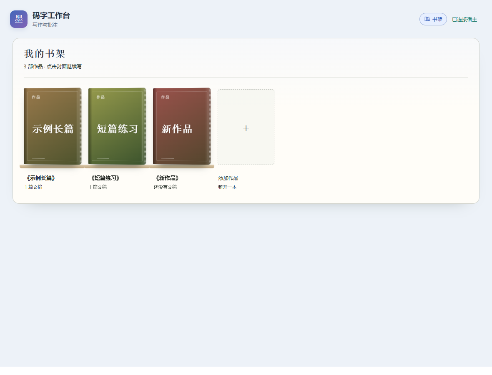

# 递笔工作台 · Writer Workbench

递笔工作台是一款面向小说作者和其他文字创作者的本地码字工具，支持在 Codex 或 DeepSeek Harness（DSH）里管理作品、编辑文稿、记录创作进度，并与 AI 协作写作。

[观看 42 秒介绍视频](https://github.com/Aether-folio/writer-workbench/releases/download/v0.5.0/writer-workbench-demo.mp4) · [下载 v0.5.0 Windows 安装包](https://github.com/Aether-folio/writer-workbench/releases/download/v0.5.0/writer-workbench-v0.5.0-windows.zip)

它把码字与讨论放在同一个工作空间：作者选中需要讨论的段落，在工作台填写要求后直接发送到当前聊天，也可以在任意光标位置请求 AI 补写。通过统一的「递笔」入口填写要求，支持暂存为原位批注和批量直发。生成内容以正文淡背景预览，可编辑、对照、采纳、再递笔或不采纳。

> AI 只是工具，真正的创作与好创意，始终来自作者的生活、想象与判断。愿这张小小的码字桌，能陪各位天之骄子把灵感写成故事。祝每一位笔者都能写出自己的代表作，早日成为白金大神。

## 功能

- **AI 协作写作**：围绕具体文稿与 AI 讨论构思、情节、人物、节奏和表达，辅助分析与修改，由作者决定如何采用建议。
- **AI 定点插入**：支持段首、段中、段尾和空行；待采纳内容以红字和浅红底原位展示，可编辑、采纳、再递笔和不采纳。
- **带着原文讨论**：选区或光标处点击「递笔」，暂存为原位批注或直接发送；批注可逐条发送、全部发送，也可单条删除或一键清空，重启后仍保留。
- **发送与换行**：要求输入框 Enter 发送，Shift+Enter 换行；中文输入法确认不误发。聊天只展示文稿与要求，定位上下文通过工具读取。
- **我的书架**：用封面展示作品、草稿与散篇，显示文稿数量和最近更新，点击封面继续写作。
- **作品管理**：书架上右键重命名作品、更换或移除封面。支持选择 32 MB 以内的 PNG、JPG 或 WebP，大图会在本地缩放并压缩后保存。空作品可直接新建第一篇文稿。
- 作品文件树、Markdown 大纲、文稿/文件夹重命名、可调宽度侧栏。
- 自动保存、可对照恢复的覆盖前备份、外部修改冲突保护。
- **AI 改写对照**：在正文查看可编辑的改稿，在改稿旁查看原文，按需采纳、重新递笔或取消。
- **文本对照**：点击文稿侧栏底部的「文本对照」图标，输入或选取两个工作台文稿的相对路径，即可查看段落差异。
- **正文分卷**：正文旁的加号新增卷，卷旁的加号新增文稿。已有未分卷章节打开作品时会归入第一卷。右键正文或某一卷可设置章节排序，正文旁显示总字数。
- **一键整理**：在侧栏点击清单图标，通过当前聊天整理新增或改动的章节。整理完成后自动打开「设定 / 大纲 / 进度.md」，最新章节在前；主要情节、伏笔与连贯性要点会供后续递笔参考。可在文件的「手记」区补充自己的笔记。
- 章节查找替换、整本分页搜索；同部作品的可选设定/大纲等参考资料。
- 每章光标与滚动恢复；侧栏底部的「设置」集中放背景、字号、行距、段距、正文宽度、减少动画和侧栏左右位置；正文里按住 Ctrl 滚动滚轮可直接调字号。
- **液体玻璃主题**：在「设置 → 外观」切换原生与液体玻璃；玻璃有海盐蓝、雾丁香、青梨绿、杏仁奶、云朵白、暮夜灰六款色系，支持调节磨砂程度。原生的六款底色和自定义颜色分别保留。
- 设置按「外观 / 排版 / 布局」分页，提供主题与排版预览。切换字体时先更新预览，点击「完成」后应用到整个工作台。内置龙藏体和马善政毛笔楷书，许可见 [字体目录](assets/fonts/README.md)。更新后重启客户端加载新增设置字段，再重新打开工作台。
- 回收站恢复与单条彻底删除；彻底删除前确认。
- 北京时间码字日历、新增/删除字数、码字与空闲时长。
- 码字统计面板固定在文稿侧栏里，全屏写作时单独浮起；可显示作品封面、可选信息及龙娘或大肥鱼动图。侧栏够宽时封面与萌宠同排，窄栏时封面居中。
- 全屏写作保留标题、正文与统计面板；右上角按钮或 Esc 退出。
- 品牌留在侧栏顶部，书架、连接状态、文本对照、设置和码字统计位于侧栏底部。批注为空时自动收起，给统计卡片腾出空间。工作台变宽时保持设计宽度，不会把空白等比例放大。



[写作界面](docs/images/workbench.png) · [全屏写作](docs/images/fullscreen.png)

截图使用程序生成的示例内容。介绍视频单独随 GitHub Release 提供，源码和安装包不包含录制工程或演示文稿数据。

## Windows 一键安装

下载并解压安装包到希望长期保留的目录。需要 Node.js 22+ 和所选宿主的命令行工具。DeepSeek Harness 需先打开一次以创建桌面 profile。在解压目录打开 PowerShell，按宿主选择一条命令。

```powershell
& .\install.ps1 -HostApp Codex -SkipBuild
& .\install.ps1 -HostApp DeepSeek -SkipBuild
```

两端都安装可用 `-HostApp Both -SkipBuild`。安装完成后重启客户端，说「打开递笔工作台」。升级时，如已有作品目录，通过 `-Workspace <现有目录>` 指定原工作区，或继续使用已有的宿主配置。从源码目录安装时去掉 `-SkipBuild`，脚本会安装依赖并构建。

## 构建

需要 Node.js 22+、npm，以及对应的本地客户端。

```sh
npm ci
npm run build
```

一次构建同时生成 `dist/`、Codex 的 `runtime/` 和 DSH 的 `dsh/lib/`、`dsh/assets/editor.html`，避免两边版本不一致。这些产物不提交到源码仓库。

## Codex 安装

1. 完成构建。
2. 注册仓库自带的本地插件源，在仓库目录执行：

   ```sh
   codex plugin marketplace add .
   codex plugin add writer-workbench@writer-tools-local
   ```

3. 重启客户端，再说“打开递笔工作台”。也可从客户端的插件目录选择本地插件源安装。

源码启动配置使用 `${PLUGIN_ROOT}` 占位符。构建和 Windows 安装脚本会在安装机器的 `runtime/` 中生成 Node.js 和服务路径。需要指定其他数据目录时，可在安装时传入 `-Workspace`，或构建后运行 `node scripts/configure-local.mjs <工作区绝对路径>` 再重新安装。

安装格式参考 [OpenAI 本地 MCP 插件说明](https://developers.openai.com/plugins/deploy/desktop-only) 和 [本地插件源说明](https://developers.openai.com/plugins/build/plugins)。不同客户端版本对安装命令和占位符的支持可能不同。

## DeepSeek Harness 安装

两边共用源码，DSH 有独立的宿主桥和右侧栏入口。完成构建后：

```powershell
.\dsh\install.ps1 -Profile desktop
```

若 `dsh` 不在 PATH，通过 `-DshCmd` 指定命令路径；通过 `-Workspace` 指定数据目录。重启 DSH 后，使用聊天输入框旁的“递笔”按钮或说“打开递笔工作台”。详见 [DSH 安装说明](dsh/README.md)。

## 数据位置与隐私

Codex 与 DSH 默认使用用户主目录下的 `WriterWorkspaces/`，可以通过 `WORKBENCH_WORKSPACE` 或宿主的工作区设置覆盖。数据保存在 `<workspace>/码字工作台/`。已有 DSH profile 配置会保留。两边指向同一个工作区即可共用数据，编辑同一文稿时建议只使用一个客户端。

每部作品使用自己的 `正文/`、`设定/`、`草稿/`。工作台不再预建空的顶层 `文稿/`；已有目录及其中的文件仍可正常读取，不会自动删除。

文稿、自动备份、回收站、封面、每日码字记录与待处理 AI 建议都保存在本机。AI 建议采纳前不写入正文、不计入字数；采纳时保存并保留覆盖前备份。批注、每轮建议版本和阅读位置保存在本地；成功发送后转入等待状态，失败保留，可重试。加入聊天的内容将由所用客户端及其服务处理，请自行决定添加哪些文字。

所有运行数据目录、构建产物、日志和测试截图都在 `.gitignore` 中。提交前运行 `npm run privacy:check`，并检查实际暂存文件清单。隐私脚本是辅助检查，不能代替对待提交文件的审阅。

## 验证

```sh
npm test
npm run test:dsh
npx playwright install chromium
npm run test:focus
npm run test:shelf
npm run test:chat
npm run test:writing
```

封面在书架上右键管理，码字统计设置只控制封面与其他信息的展示。统计面板固定在文稿侧栏底部；进入全屏写作时，按原来的悬浮窗单独浮动（可拖动、方向键移动，本次打开期间记住位置），退出全屏后自动回到侧栏。书架显示时暂时隐藏。

`npm run test:browser` 运行递笔全流程、批量并发边界、段落编辑、书架及回收站浏览器回归；`node tests/paragraph-editor.browser.cjs` 检查段落编辑。浏览器测试使用合成文稿和模拟宿主，结果写入被忽略的 `test-results/`。可用 `PLAYWRIGHT_CHANNEL=msedge` 等环境变量选择已有浏览器。

## 目录

```text
src/               共享编辑器与本地数据逻辑
scripts/           构建、本机配置与发布文件检查
tests/             合成数据测试
skills/            Codex 写作工作台技能
.codex-plugin/     Codex 插件清单
.agents/plugins/   本地插件源清单
dsh/               DSH 宿主桥、客户端及技能
assets/            图标与内置萌宠动图
docs/              文档与合成示例截图
```

代码采用 [MIT 许可证](LICENSE)。

