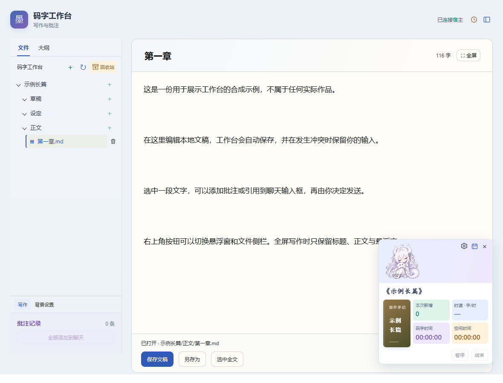

# 码字工作台 · Writer Workbench

码字工作台是一款面向小说作者和其他文字创作者的本地码字工具，支持在 Codex 或 DeepSeek Harness（DSH）里管理作品、编辑文稿、记录创作进度，并与 AI 协作写作。

它把码字与讨论放在同一个工作空间：作者选中需要讨论的段落，写下疑问、修改方向或需要补充的背景，再将原文与批注整理到聊天输入框。确认发送后，可以请 AI 一起梳理情节、推敲人物动机、检查前后逻辑或讨论表达方式。作者掌握创作方向，选择采纳哪些建议，并在编辑区完成修改。

## 功能

- **AI 协作写作**：围绕具体文稿与 AI 讨论构思、情节、人物、节奏和表达，辅助分析与修改，由作者决定如何采用建议。
- **带着原文讨论**：选区引用和临时批注汇总到聊天输入框，把原文、疑问与修改要求一起交给 AI，内容由作者确认发送。
- 作品与文件树、Markdown 大纲、文稿/文件夹重命名、可调宽度侧栏。
- 自动保存、覆盖前备份、外部修改冲突保护。
- 回收站恢复与单条彻底删除；彻底删除前确认。
- 北京时间码字日历、新增/删除字数、码字与空闲时长。
- 右下角悬浮窗、作品封面、可选信息及龙娘/大肥鱼动图。
- 全屏写作保留标题、正文与悬浮窗；右上角按钮或 Esc 退出。
- 右上角悬浮窗开关和侧栏按钮，不受侧栏缩窄影响。



截图使用程序生成的示例内容。本仓库不包含使用者的文稿、草稿、封面、码字记录或本地配置。

## 构建

需要 Node.js 22+、npm，以及对应的本地客户端。

```sh
npm ci
npm run build
```

一次构建同时生成 `dist/`、Codex 的 `runtime/` 和 DSH 的 `dsh/lib/`、`dsh/assets/editor.html`，避免两边版本不一致。这些产物不提交到源码仓库。

## Codex 安装

1. 完成构建。
2. 注册仓库自带的本地插件源，在仓库目录执行：

   ```sh
   codex plugin marketplace add .
   codex plugin add writer-workbench@writer-workbench-local
   ```

3. 重启客户端，再说“打开码字工作台”。也可从客户端的插件目录选择本地插件源安装。

通用启动配置使用官方支持的 `${PLUGIN_ROOT}` 占位符。若当前客户端未展开占位符，可先运行 `node scripts/configure-local.mjs` 生成仅用于本机的运行包配置，再重新安装。需要指定数据目录时，把目录作为该脚本的第一个参数传入。构建会重置这份本机配置，之后需再次运行配置脚本。

安装格式参考 [OpenAI 本地 MCP 插件说明](https://developers.openai.com/plugins/deploy/desktop-only) 和 [本地插件源说明](https://developers.openai.com/plugins/build/plugins)。不同客户端版本对安装命令和占位符的支持可能不同。

## DeepSeek Harness 安装

两边共用源码，DSH 有独立的宿主桥和右侧栏入口。完成构建后：

```powershell
.\dsh\install.ps1 -Profile desktop
```

若 `dsh` 不在 PATH，通过 `-DshCmd` 指定命令路径；通过 `-Workspace` 指定数据目录。重启 DSH 后，使用聊天输入框旁的“码字”按钮或说“打开码字工作台”。详见 [DSH 安装说明](dsh/README.md)。

## 数据位置与隐私

默认数据在用户目录的 `.writer-workbench/码字工作台/`。设置 `WORKBENCH_WORKSPACE` 可覆盖数据根目录；DSH 也支持 `config.workspace`。两边指定相同目录即可共用数据，编辑同一文稿时建议只使用一个客户端。

文稿、自动备份、回收站、封面和每日码字记录都保存在本机。批注仅在当前工作台页面内存中，关闭或刷新后清空；成功添加到聊天草稿后移除对应记录。加入聊天的内容将由所用客户端及其服务处理，请自行决定添加哪些文字。

所有运行数据目录、构建产物、日志和测试截图都在 `.gitignore` 中。提交前运行 `npm run privacy:check`，并检查实际暂存文件清单。隐私脚本是辅助检查，不能代替对待提交文件的审阅。

## 验证

```sh
npm test
npm run test:dsh
npx playwright install chromium
npm run test:focus
```

`npm run test:browser` 为完整浏览器回归；`node tests/paragraph-editor.browser.cjs` 检查段落编辑。浏览器测试使用合成文稿和模拟宿主，结果写入被忽略的 `test-results/`。可用 `PLAYWRIGHT_CHANNEL=msedge` 等环境变量选择已有浏览器。

## 目录

```text
src/               共享编辑器与本地数据逻辑
scripts/           构建、本机配置与发布文件检查
tests/             合成数据测试
skills/            Codex 写作工作台技能
.codex-plugin/     Codex 插件清单
.agents/plugins/   本地插件源清单
dsh/               DSH 宿主桥、客户端及技能
assets/            图标与内置萌宠动图
docs/              文档与合成示例截图
```

代码采用 MIT 许可证。开发版尚需在所使用的客户端版本中实际验证安装与界面行为。
